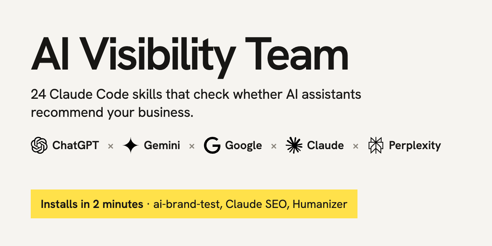

# AI Visibility Team for Claude Code

24 skills that check whether ChatGPT, Gemini, Google, Claude and Perplexity recommend your business, and help you fix what stops them.

## Install (2 minutes)

All you need is [Claude Code](https://claude.com/product/claude-code). Paste this into it:

```
Install the AI Visibility Team from https://github.com/theonlyalexmorningstar/ai-visibility-team: clone it, run install.sh, run ~/.claude/skills/seo/scripts/claude-seo setup, then ask me for my treg.to key and save it to ~/.config/treg/key. If git or Python 3 is missing on my computer, install it first and tell me what you did.
```

You'll need a [treg.to](https://treg.to) key for the brand test. Then ask: *"Does ChatGPT recommend my business? Run the AI brand test."*

## The test

`ai-brand-test` asks your buyers' questions in the live ChatGPT and Gemini apps, Google AI Overviews, Google AI Mode, Claude and Perplexity. It shows how often you are named, how often first, the questions where you are missing, and which websites the answers came from. One key, about $0.50 for a 20-question test.

Claude answers from its own knowledge, without a web search. Grok is not in the test yet: there is no way to query it through the same key.

## The team

| AI search | Audit | Content | Site and local | Data |
|---|---|---|---|---|
| `seo-geo`: get cited in AI answers | `seo`: full site analysis | `seo-plan`: strategy by industry | `seo-schema`: structured data AI can read | `seo-google`: Search Console and GA4 |
| `seo-agentic`: ready for AI agents | `seo-audit`: scored site-wide audit | `seo-content-brief`: briefs that beat rivals | `seo-sitemap`: sitemaps that get crawled | `seo-backlinks`: who links to you |
| `seo-content`: is the page worth citing | `seo-page`: one URL, every check | `seo-competitor-pages`: "X vs Y" pages | `seo-hreflang`: right page per language | `seo-dataforseo`: live SERP and keywords |
| `humanizer`: text that doesn't sound AI | `seo-technical`: crawl, index, speed | `seo-programmatic`: pages at scale | `seo-local`: Google Business Profile | `seo-firecrawl`: crawl a whole site |
| | `seo-images`: alt text, size, format | `seo-image-gen`: hero and social images | `seo-maps`: map rankings by area | |

Some SEO skills use paid or keyed services (DataForSEO, Firecrawl, Google APIs, an image model); `/seo setup` explains what each needs. The installer adds all 26 Claude SEO skills; the table shows the 22 that matter most for AI visibility.

Questions or results worth sharing: message [Alex Andronov](https://www.linkedin.com/in/alex-andronov) on LinkedIn.

## Credits and licences

- `ai-brand-test` and the installer: © 2026 Alex Andronov, MIT licence (see `LICENSE`).
- [Claude SEO](https://github.com/AgriciDaniel/claude-seo): © 2026 Daniel Agrici, MIT licence. Installed by its own installer from its own repository; not modified or redistributed here.
- [Humanizer](https://github.com/blader/humanizer): © 2025 Siqi Chen, MIT licence. Cloned from its own repository.
